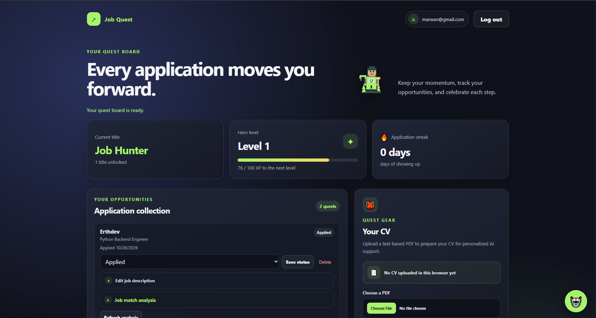
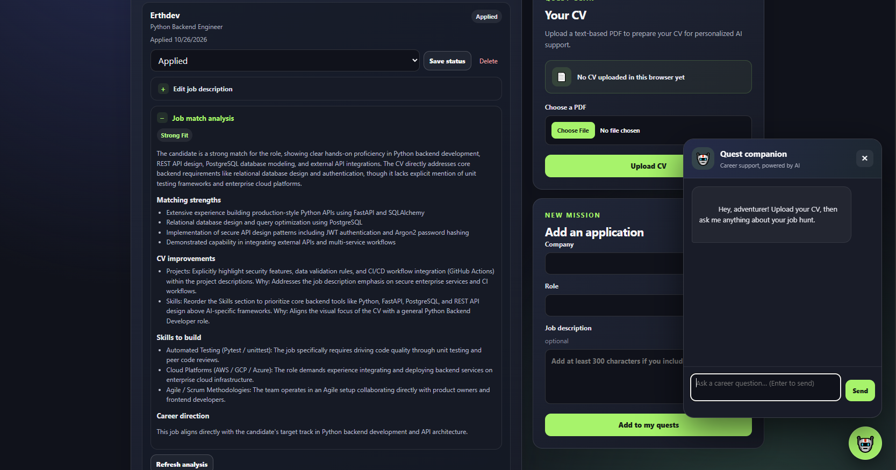
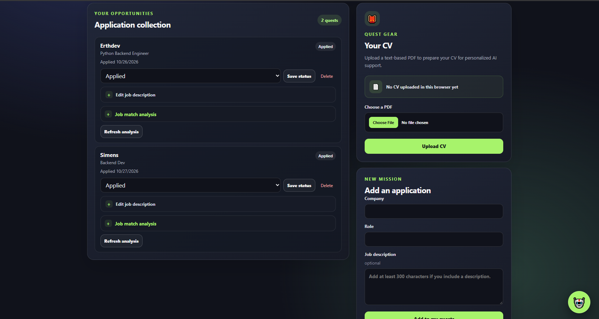

# Job Quest


<p align="center">
  
  
  
</p>
An AI-powered job application tracker and career assistant. Track every application, keep a daily streak going, level up as you progress, and get honest AI feedback on how your CV fits each job.

Built with **FastAPI**, **PostgreSQL**, and **Google Gemini**, with a lightweight vanilla JavaScript frontend.

## Features

- **Application tracker.** Add, update, and delete applications (company, role, job description, status: Applied / Interview / Rejected / Offer).
- **Gamified progress.** XP, levels, unlockable titles, and a daily application streak.
- **CV upload.** Upload a PDF resume. It is stored in Supabase Storage and its text is extracted for the AI features.
- **AI career coach.** A chat assistant that answers using your CV as its only source of truth. It points out weaknesses instead of flattering you.
- **Job match analysis.** Compares your CV against one job description and returns a structured result: fit level, strengths, CV edits, skills to learn, and whether the job matches your career direction.
- **Authentication.** Registration with password-strength rules, login with JWT access tokens.
- **Per-user data isolation.** Every query is scoped to the logged-in user.

## Tech stack

| Area | Tools |
|---|---|
| API | FastAPI, Pydantic v2, Uvicorn |
| Database | PostgreSQL (hosted on Supabase), SQLAlchemy 2.0 |
| File storage | Supabase Storage (CV PDFs), pypdf for text extraction |
| Auth | Argon2 password hashing, JWT (python-jose) |
| AI | Google Gemini via `google-genai` (structured JSON output for the analysis) |
| Frontend | HTML, CSS, vanilla JavaScript |
| Testing | pytest, FastAPI `TestClient`, PostgreSQL in Docker |
| Packaging | Docker |

## Project structure

```
job-quest-app/
├── main.py              # App entry point, CORS, router registration
├── core/                # Settings, DB engine/session, auth helpers (hashing, JWT)
├── models/              # SQLAlchemy models (User, Application, Resume, Chat)
├── schemas/             # Pydantic request/response models
├── routers/             # HTTP routes (authentication, application, upload, ai_assistant)
├── db_ops/              # Database queries, kept out of the routes
├── services/            # Gamification logic, AI (Gemini) calls, PDF/file handling
├── frontend/            # Static pages: landing, login, register, dashboard
├── tests/               # pytest suite (auth, applications, gamification)
├── Dockerfile
└── requirements.txt
```

The code is layered: **routers** handle HTTP and error mapping, **db_ops** talk to the database, and **services** hold business logic and external calls.

## API overview

Interactive docs are available at `/docs` when the server is running.

| Method | Path | Auth | Description |
|---|---|---|---|
| POST | `/register` | No | Create an account (JSON: `email`, `password`) |
| POST | `/login` | No | Get a JWT (form fields: `username` = email, `password`) |
| POST | `/upload` | Yes | Upload a PDF CV (multipart field `cv_file`) |
| POST | `/add_application` | Yes | Create an application |
| GET | `/get_applications` | Yes | List your applications |
| PATCH | `/update_application/{id}` | Yes | Update status and/or job description |
| DELETE | `/delete_application/{id}` | Yes | Delete an application |
| GET | `/progress` | Yes | Streak, level, XP progress, titles |
| POST | `/ask` | Yes | Chat with the AI career coach (needs an uploaded CV) |
| POST | `/application_analysis/{id}` | Yes | AI match analysis for one application (needs a CV and a job description) |
| GET | `/` | No | Health check |

Protected routes expect an `Authorization: Bearer <token>` header.

## Gamification rules

- Every application is worth **10 XP**.
- Milestone titles unlock at 1, 5, 10, 25, 50, 60, 85, and 100 applications, each with a small bonus XP.
- Status titles unlock at 1, 3, 5, and 10 applications in **Interview** (+50 XP each) and in **Offer** (+100 XP each).
- **Level** = `XP // 100 + 1`.
- **Streak** = consecutive days with at least one application. It stays alive if your latest application was today or yesterday.

## Getting started

### Prerequisites

- Python 3.12 or newer
- A PostgreSQL database (a free Supabase project works)
- A Supabase Storage bucket named **`resumes`**
- A Google Gemini API key
- Docker (optional, for the container and for running the tests)

### 1. Configure the environment

Copy `.env.example` to `.env` and fill in the values:

| Variable | Required | Description |
|---|---|---|
| `DATABASE_URL` | Yes | PostgreSQL connection string |
| `SECRET_KEY` | Yes | Long random string used to sign JWTs |
| `SUPABASE_URL` | Yes | Your Supabase project URL |
| `SUPABASE_KEY` | Yes | Supabase API key used by the backend for Storage |
| `GOOGLE_API_KEY` | Yes | Gemini API key |
| `ALGORITHM` | No | JWT algorithm (default `HS256`) |
| `ACCESS_TOKEN_EXPIRE_MINUTES` | No | Token lifetime (default `30`) |
| `ALLOWED_ORIGINS` | No | Comma-separated frontend origins for CORS (default `http://localhost:5500`) |

Generate a secret key with:

```bash
python -c "import secrets; print(secrets.token_urlsafe(48))"
```

### 2. Run the backend

```bash
python -m venv .venv
source .venv/bin/activate        # Windows: .venv\Scripts\activate
pip install -r requirements.txt
uvicorn main:app --reload
```

The API runs on `http://127.0.0.1:8000`. Tables are created automatically on startup.

### 3. Run the frontend

The frontend is static. Point it at your API in `frontend/config.js`:

```js
window.API_URL = "http://127.0.0.1:8000";
```

Then serve the folder on port 5500, for example:

```bash
cd frontend
python -m http.server 5500
```

Open `http://localhost:5500`. Use `localhost`, not `127.0.0.1`: CORS matches the origin exactly, and the default allowed origin is `http://localhost:5500`.

### Run with Docker

```bash
docker build -t job-quest-app .
docker run -d --name job-quest-app --env-file .env -p 8000:8000 job-quest-app
```

## Running the tests

The tests run against a separate, disposable PostgreSQL database, never your real one. The test setup overrides `DATABASE_URL` before the app is imported, creates the tables for each test, and drops them afterwards.

```bash
# 1. Start a throwaway Postgres on port 5433
docker run --name jobquest-test-db -e POSTGRES_PASSWORD=test -e POSTGRES_DB=jobquest_test -p 5433:5432 -d postgres:16

# 2. Run the suite
pytest -v
```

The app still reads `SUPABASE_URL`, `SUPABASE_KEY`, `GOOGLE_API_KEY`, and `SECRET_KEY` when it is imported, so those need to be set (your `.env` is enough locally; any dummy values work for the Supabase and Gemini ones).

What is covered:

- **Auth:** registration, duplicate emails, password-strength rules, login success and failure, protected routes.
- **Applications:** create, duplicates (per user), update, delete, and that one user can never read, change, or delete another user's data.
- **Gamification:** level boundaries, streak rules, title unlocks.

## Design notes

- **User isolation.** Every application query filters by `user_id`. Another user's record is reported as "not found" (404), so its existence is not revealed.
- **Login errors.** An unknown email and a wrong password return the same 401 message, so the API can't be used to discover registered emails.
- **Passwords.** Hashed with Argon2. Strength rules are enforced by a Pydantic validator, and the hash never appears in any response.
- **AI safety.** The CV and the job description are wrapped in tags and treated as data in the prompts, so instructions hidden inside them are not followed. The analysis uses a response schema, so the model must return structured JSON.
- **Chat memory.** The assistant sees the last 40 messages of your conversation.

## Known limitations

- Tables are created with `create_all` on startup; there are no migrations yet, so schema changes need a manual update.
- No rate limiting on the API.
- The frontend stores the JWT in `localStorage` and remembers your uploaded CV link per browser.
